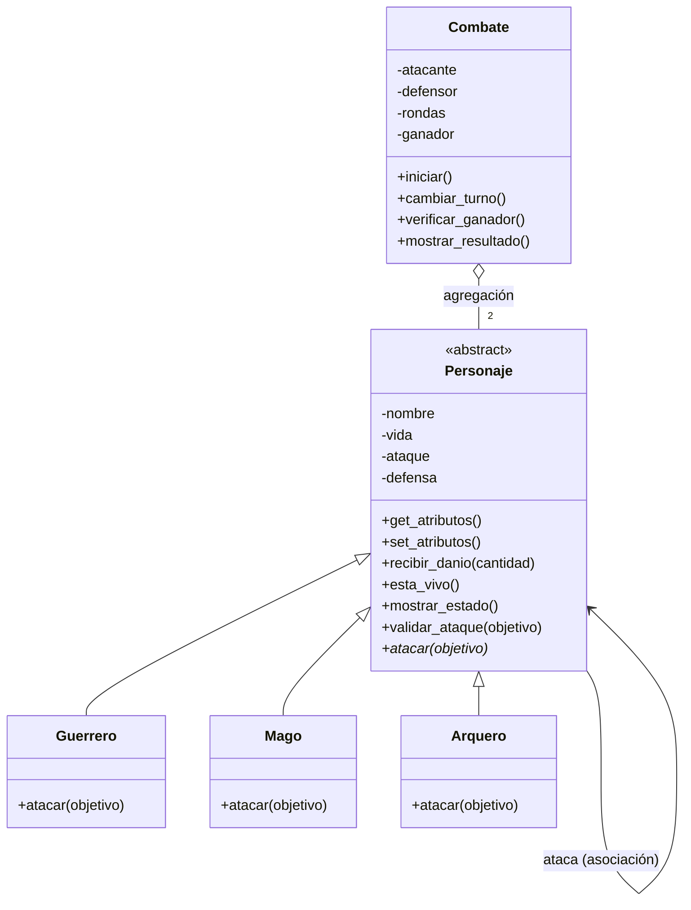

# Guardians of the Ancient Kingdom

## 1. Descripción
Es un programa en Python con POO que simula un combate por turnos entre dos guardianes del reino de Eldoria: Guerrero, Mago o Arquero. Cada uno ataca de forma diferente, el programa lleva los turnos, resta la vida y dice quién ganó o si hubo empate.

## 2. Estructura
- `personajes.py`: contiene las clases `Personaje`, `Guerrero`, `Mago`, `Arquero` y `Combate`. No ejecuta nada al importarlo.
- `main.py`: crea personajes, muestra las habilidades, las validaciones y un combate de ejemplo, y tiene las pruebas de pytest.
- `README.md`: la documentación.

## 3. Clases
- **Personaje**: clase abstracta con los datos comunes (nombre, vida, ataque, defensa), sus getters y setters con validación, y los métodos `recibir_danio()`, `esta_vivo()`, `mostrar_estado()` y `validar_ataque()`. Deja `atacar()` abstracto.
- **Guerrero**: *Golpe poderoso*. Daño = `ataque × 1.20 − defensa` del objetivo, redondeado hacia abajo y nunca menor que 0.
- **Mago**: *Hechizo penetrante*. Daño = su ataque, ignorando la defensa.
- **Arquero**: *Disparo crítico*. Si su ataque supera la defensa, daño = `(ataque − defensa) × 2`; si no, 0.
- **Combate**: controla quién ataca, cuenta las rondas, busca al ganador y muestra el resultado.

## 4. Relaciones
- **Herencia**: Guerrero, Mago y Arquero *son* un Personaje. La usé para no repetir los atributos ni `recibir_danio()` en cada clase.
- **Asociación**: cuando se hace `atacante.atacar(objetivo)`, los dos objetos se comunican con sus métodos, pero ninguno es parte del otro.
- **Agregación**: `Combate` recibe dos personajes que ya estaban creados, los usa, pero no los crea. Un combate *tiene* participantes.

### Diagrama UML (Reto 1)

La flecha con triángulo es la herencia: las tres clases heredan de `Personaje` y cada una implementa su `atacar()` (el `*` marca que es abstracto en la clase base). La flecha simple de Personaje a Personaje es la asociación cuando uno ataca a otro. El rombo vacío significa que `Combate` agrega dos personajes que existen por separado.

## 5. Conceptos de POO
- **Abstracción**: `Personaje` usa `ABC` y `@abstractmethod`, así que no se puede crear un Personaje directamente.
- **Encapsulamiento**: los atributos son privados (`__vida`, etc.) y solo se cambian con los setters, que validan los valores (vida entre 0 y 100, ataque mayor que 0, defensa mayor o igual a 0, nombre no vacío) y lanzan `ValueError` si algo está mal.
- **Herencia**: las subclases usan el constructor, los getters, los setters y `recibir_danio()` de `Personaje`.
- **Polimorfismo**: `Combate` solo llama `self.atacante.atacar(self.defensor)`. Cada personaje hace su propio cálculo y `Combate` nunca pregunta si es Guerrero, Mago o Arquero.

## 6. Lógica del combate
- **Daño**: cada clase calcula su daño y se lo manda al objetivo con `recibir_danio()`, que lo limita a la vida que le queda (nunca negativa) y devuelve el daño real. El 20 % del Guerrero se calcula con enteros (`ataque * 120 // 100`) para no usar decimales.
- **Turnos**: una ronda son dos ataques, uno de cada personaje. `cambiar_turno()` intercambia al atacante con el defensor, y después de cada ataque se muestra el estado de los dos y se llama `verificar_ganador()`.
- **Final**: gana el que deja al otro con 0 de vida. Si una ronda completa no causa daño es empate técnico, y si pasan 50 rondas sin ganador es empate.

## 7. Ejecución
```bash
git clone <URL-DEL-REPOSITORIO>
cd Guardians-of-the-Ancient-Kingdom
pip install pytest
python main.py
```

## 8. Pruebas
Se comprobó la creación de los tres tipos, el rechazo de vida mayor a 100 o negativa, nombres vacíos, ataque y defensa inválidos, las habilidades de los tres personajes, que la vida nunca sea negativa, que un derrotado no pueda atacar, un combate completo con ganador y los dos tipos de empate. Todas las pruebas pasaron.

### Pytest (Reto 2)
Pytest es una herramienta de Python que busca las funciones que empiezan por `test_`, las ejecuta y revisa si los `assert` son verdaderos. Sirve para que las pruebas se repitan solas y no haya que revisar mensajes a mano. Las pruebas están en `main.py` y se ejecutan con:
```bash
pytest main.py -v
```
Resultado:
```text
collected 22 items
main.py::test_crear_guerrero PASSED
main.py::test_crear_mago PASSED
main.py::test_crear_arquero PASSED
main.py::test_personaje_es_abstracto PASSED
main.py::test_vida_mayor_a_100 PASSED
main.py::test_vida_negativa PASSED
main.py::test_nombre_vacio PASSED
main.py::test_ataque_invalido PASSED
main.py::test_defensa_invalida PASSED
main.py::test_setters PASSED
main.py::test_habilidad_guerrero PASSED
main.py::test_habilidad_mago_ignora_defensa PASSED
main.py::test_habilidad_arquero_critico PASSED
main.py::test_arquero_sin_superar_defensa PASSED
main.py::test_vida_no_negativa PASSED
main.py::test_danio_negativo PASSED
main.py::test_derrotado_no_ataca PASSED
main.py::test_objetivo_invalido PASSED
main.py::test_combate_completo_y_ganador PASSED
main.py::test_empate_tecnico PASSED
main.py::test_empate_50_rondas PASSED
main.py::test_combate_invalido PASSED
============================== 22 passed in 0.47s ==============================
```

Combate de ejemplo (cada fila es un ataque):

| Ataque | Atacante | Daño | Vida Arthas | Vida Gandalf |
|---|---|---|---|---|
| Inicio | — | — | 100 | 80 |
| 1 | Arthas | 26 | 100 | 54 |
| 2 | Gandalf | 40 | 60 | 54 |
| 3 | Arthas | 26 | 60 | 28 |
| 4 | Gandalf | 40 | 20 | 28 |
| 5 | Arthas | 26 | 20 | 2 |
| 6 | Gandalf | 20 efectivo | 0 | 2 |

**Ganador: Gandalf.**

## Reto de abstracción
**¿Por qué `atacar()` debe ser abstracto, pero `recibir_danio()` puede estar implementado en la clase base?**

La clase `Personaje` representa lo que tiene y puede hacer cualquier guardián, pero no puede decidir cosas que cambian según la orden. Todos los personajes comparten la vida y la forma de perderla: el daño llega ya calculado, se resta, la vida no baja de 0 y se devuelve el daño real. Por ejemplo, cuando Gandalf atacó a Arthas, que tenía 20 de vida, `recibir_danio(40)` lo dejó en 0 y devolvió 20. Esa misma regla sirve para un Mago, un Guerrero o un Arquero.

En cambio, la forma de atacar es justo lo que diferencia a cada clase: el Guerrero hace `30 × 1.2 − 10 = 26`, el Mago hace 40 sin mirar la defensa y el Arquero duplica el daño si su ataque supera la defensa. No existe una fórmula única que sirva para los tres. Si `Personaje` tuviera una por defecto, una clase nueva podría olvidar cambiarla y atacar mal sin que el programa avise. Con `@abstractmethod`, Python obliga a cada hija a escribir su propio ataque y no permite crear un `Personaje` suelto.

Reutilizar `recibir_danio()` evita escribir lo mismo tres veces y evita errores, como olvidar en una clase que la vida no puede ser negativa. También protege el encapsulamiento, porque ninguna hija toca `__vida` directamente.

Con esto se ven los tres conceptos: la **abstracción** define qué se puede hacer (`atacar`) sin decir cómo; la **herencia** permite reutilizar `recibir_danio()` y las validaciones; y el **polimorfismo** hace que `Combate` llame a `atacar()` sin saber el tipo y que cada objeto responda a su manera. Por eso se podría agregar un nuevo guardián, como un `Paladin`, creando una clase con su `atacar()` sin cambiar `Combate`.
